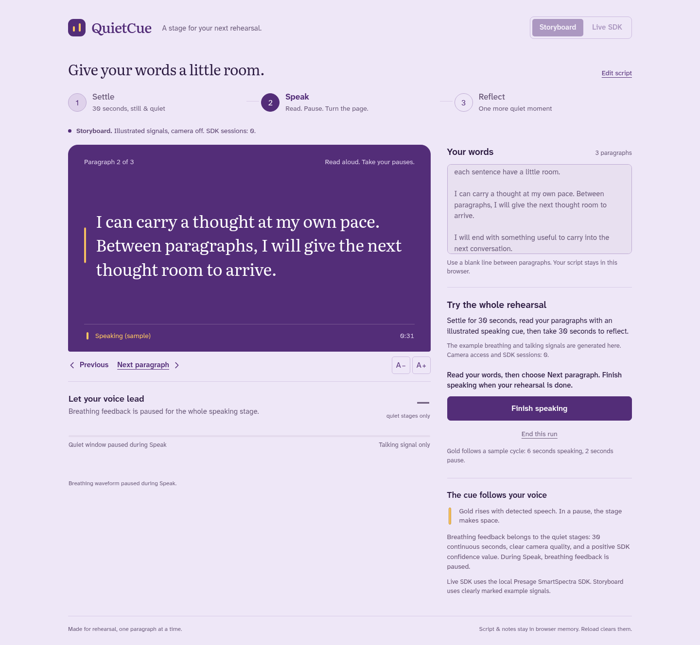

# QuietCue

A rehearsal stage for your own words: settle quietly, speak one paragraph at a
time, then take a quiet look back. Live SmartSpectra talking detection moves the
speaking cue; breathing feedback is shown during valid, still, quiet windows.

Built as a new project during the November 4–22, 2026 Presage DEV challenge.
Current delivery: native integration and a complete rehearsal interface. The
Storyboard replays the whole task with illustrated signals. Next milestone:
one adult camera rehearsal and its real SDK demo video.



[Try the Storyboard](https://blucca.github.io/quietcue/) or run the SDK on your own computer.

## Run on your computer

Requires Node 20+, a local camera or a consented MP4, and your own free
[SmartSpectra developer API key](https://physiology.presagetech.com/auth/register).
Linux requires glibc 2.35+ (Ubuntu 22.04+ or Debian 12+). The pinned SDK includes
prebuilt runtimes for Linux, macOS and Windows, about 369 MB unpacked in total.

```sh
npm install
export SMARTSPECTRA_API_KEY='your-key'
npm start
# open http://127.0.0.1:3795
```

For video-file input, set this before starting the server:

```sh
export QUIETCUE_VIDEO_PATH='/absolute/path/to/your-consented-video.mp4'
```

The SDK's native `useFile()` processes the input through the same model pipeline
as a local camera. It supplies SDK timestamps, metrics and validation callbacks.
The server uses `@smartspectra/node-sdk/messages` to decode the real protobuf
metrics. Keep your API key in your terminal environment, outside the repository.

## Complete one rehearsal

1. **Settle:** stand or sit still with a stable camera, good light and your face
   and upper chest visible. Let a continuous 30-second quiet window fill.
2. **Speak:** read your paragraph and advance when ready. Live talking detection
   animates the cue. Breathing feedback pauses during speech.
3. **Reflect:** settle quietly for another 30 seconds; review the two quiet
   measurements and the pauses in your own rehearsal. Save run notes if useful.

SmartSpectra reports a 30-second average breathing rate with confidence. Its
measurement conditions include stillness, stable camera, clear chest framing and
silence. Our feedback uses those windows; talking cues support the speaking task.

**Storyboard** illustrates the full interaction with labeled example values and
uses zero SDK sessions. A real SDK camera or file run has its own source label.

## Camera consent and data

Before a native run, the app asks the adult user to agree to the specific input
and data flow. Camera frames are processed by the SDK on the user's computer.
The current [SmartSpectra privacy policy](https://presagetech.com/legal/privacy-policy)
(November 3, 2026, SDK section) states that every SDK session automatically sends
derived measurements and session/request metadata to Presage, which sends
measurements to Anthropic to generate Insights. Automatic Insights continue with
`enableTelemetry: false`; that flag disables diagnostic telemetry only.

This application supplies zero prompt text to the SDK. Your rehearsal script
stays in this browser. App run notes stay in browser memory until reload; Save
Run downloads a JSON file to your own device. The application server saves zero
camera clips or run-note files by default.

Presage retains Insights requests/responses while the developer account is
active and deletes them within 60 days after account closure; backups expire
within 90 days and usage/telemetry records have up to 365-day retention. See the
current SDK policy for complete provider schedules and deletion requests.

Our app code is MIT licensed. The proprietary SmartSpectra SDK and its bundled
third-party libraries follow their own licenses and Presage's Terms of Service.
